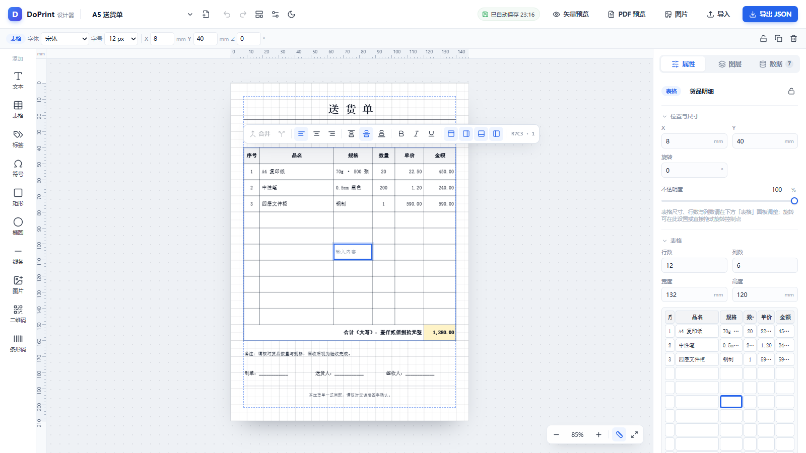
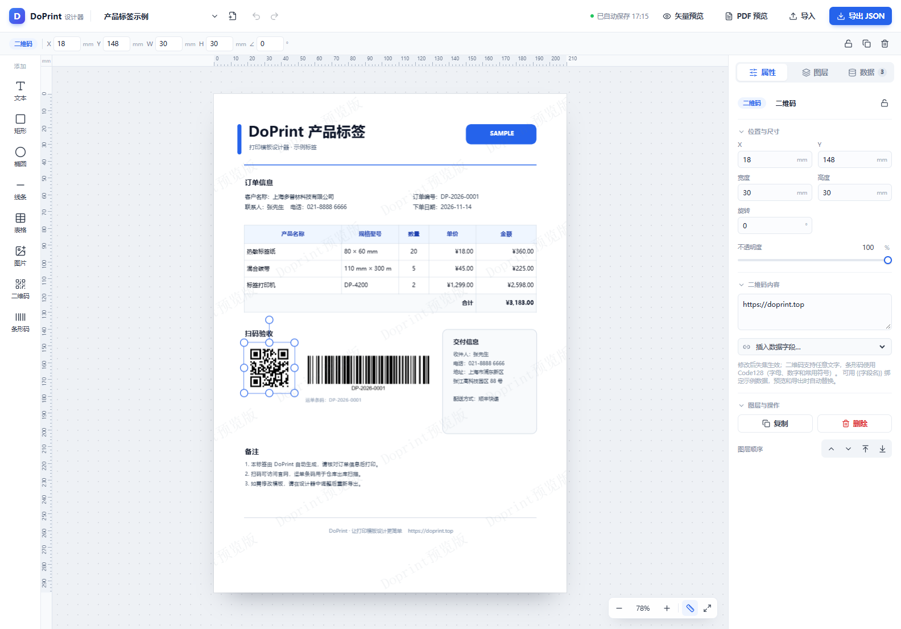
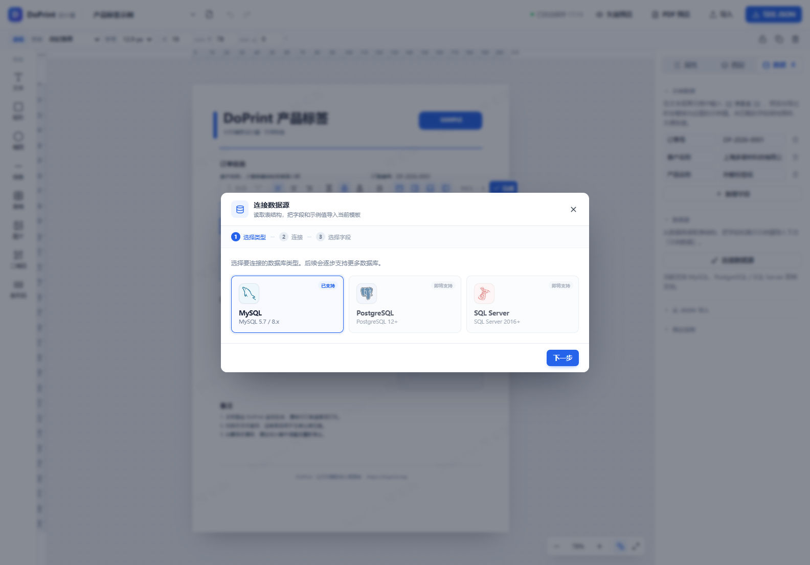

# DoPrint 设计器

面向打印场景的可视化模板设计器（Vue 3 / Vue 2.7 组件库），支持文本、图形、图片、专业表格、二维码 / 条形码、数据绑定、毫米刻度尺、参考线、多模板管理，以及 SVG / PDF 预览与导出。

[官网](https://doprint.top) · [在线体验](https://doprint.fios.top) · [GitHub](https://github.com/eonsee/doprint) · [Gitee](https://gitee.com/mayekun/doprint)


*基于在线体验环境的 A4 产品标签示例：表格、二维码 / 条形码、版权水印与页面属性面板*

## 功能特性

- **可视化设计**：文本、矩形、椭圆、线条、图片、表格、二维码、条形码均可拖拽、缩放、旋转，并支持图层排序
- **专业表格**：支持单元格编辑、合并 / 拆分、逐边边框、对齐、加粗、行高列宽与整体缩放
- **数据绑定**：文本、表格单元格、二维码和条形码都支持 `{{字段名}}`，可从示例数据、JSON 或数据库字段中导入
- **打印版式**：画布以毫米为单位，支持 A4 / A5 / B5 / 连续纸 / 标签 / 自定义纸张、页边距可视化、毫米刻度尺、拖拽参考线、网格与吸附
- **纸张底图**：可导入扫描件或已有模板图片铺在纸张最底层用于对位设计，支持显示开关、透明度、铺满 / 适应 / 拉伸，并可选是否随模板打印
- **深色主题**：顶栏按钮一键切换浅色 / 深色界面，偏好保存在浏览器；纸张与导出结果始终保持打印原色
- **二维码 / 条形码**：二维码支持 UTF-8 文本，条形码使用 Code128，可直接绑定订单号等数据
- **版权水印**：可开启 / 关闭平铺水印，默认文字为 `Doprint预览版`，随模板保存并包含在预览 / 导出中
- **多模板管理**：每个模板独立自动保存到浏览器 localStorage，可新建、切换、导入和导出
- **多种输出**：矢量预览并下载 SVG、按打印尺寸预览并下载 PDF、导出 / 导入模板 JSON
- **本地数据源**：通过本机 Node 服务读取 MySQL 库表结构和少量示例数据，密码不落盘
- **撤销 / 重做**：支持完整的编辑历史、快捷键操作和元素位置微调；撤销 / 重做时保持当前画布缩放与滚动位置

## 技术栈

| 模块 | 技术 |
| --- | --- |
| 前端框架 | Vue 3 / Vue 2.7 + TypeScript |
| 构建工具 | Vite 4 |
| 画布与交互 | Fabric.js 6 |
| 表格模型 | 自研 Univer 风格稀疏数据模型 |
| 二维码 / 条形码 | qrcode + JsBarcode |
| PDF 生成 | pdf-lib |
| 图标 | lucide-vue-next |
| 本地数据服务 | Node.js + Express + mysql2 |
| 存储 | 浏览器 localStorage（模板 / 示例数据） |

## 快速开始

建议使用 Node.js 18 或更高版本。

```bash
npm install
npm run dev
```

`npm run dev` 会同时启动：

- 设计器：http://localhost:5173
- 本地数据服务：http://127.0.0.1:3301

开发服务器会将 `/api` 代理到本地数据服务。也可以分别启动：

```bash
npm run dev:web   # 只启动前端
npm run dev:api   # 只启动数据服务
```

生产模式：

```bash
npm run build
npm start
# 打开 http://127.0.0.1:3301
```

## 集成到你的项目（npm 组件库）

设计器同时提供 **Vue 3** 与 **Vue 2.7+** 两套构建，按项目所用版本选择入口（Vue 2.6 及更早版本不支持）。两套构建都包含 ESM + CJS 与 `.d.ts` 类型声明。

### 安装与版本要求

```bash
npm install doprint-designer
```

| 依赖 | 版本 | 说明 |
| --- | --- | --- |
| Vue | `^3.5.0` 或 `^2.7.0` | peerDependency，由宿主项目提供 |
| Node.js | 18+ | 仅开发 / 构建需要，浏览器运行时不依赖 Node |

相关运行时依赖会随 `doprint-designer` 自动安装，无需单独引入；图标资源已经打进构建产物，不需要额外安装。

### 包入口

| 入口 | 内容 |
| --- | --- |
| `doprint-designer/vue3` | Vue 3 组件、`createDesigner`、`provideDesigner` / `useDesigner` 与全部类型 |
| `doprint-designer/vue3/style.css` | Vue 3 样式（必须引入） |
| `doprint-designer/vue2` | Vue 2.7 组件与类型 |
| `doprint-designer/vue2/style.css` | Vue 2 样式（必须引入） |
| `doprint-designer` | 等同于 `doprint-designer/vue3` |

### 组件属性与事件

| 属性 | 类型 | 默认值 | 说明 |
| --- | --- | --- | --- |
| `closable` | `boolean` | `false` | 在顶栏显示关闭按钮。组件不会自动隐藏，由宿主监听 `close` 后决定隐藏或卸载 |

| 事件 | 参数 | 说明 |
| --- | --- | --- |
| `ready` | `Designer` | 组件挂载完成，返回设计器实例 |
| `close` | - | 点击顶栏关闭按钮时触发（`closable` 为 `true` 时可用） |

嵌入弹窗、抽屉或页面区域时，宿主可以自行控制显示：

```vue
<template>
  <div v-if="designerOpen" class="designer-host">
    <DoPrintDesigner closable @ready="onReady" @close="designerOpen = false" />
  </div>
</template>
```

### Vue 3 集成

```vue
<!-- App.vue -->
<template>
  <!-- 容器必须有明确高度，设计器会撑满父容器 -->
  <div class="designer-host">
    <DoPrintDesigner @ready="onReady" />
  </div>
</template>

<script setup lang="ts">
import { DoPrintDesigner, type Designer, type PageTemplate } from 'doprint-designer/vue3'
import 'doprint-designer/vue3/style.css'

let designer: Designer | null = null

function onReady(instance: Designer) {
  // 组件挂载完成，拿到设计器实例
  designer = instance
}

/** 保存模板：serialize() 返回可直接 JSON 序列化的 PageTemplate */
function saveTemplate() {
  if (!designer) return
  const template: PageTemplate = designer.serialize()
  return JSON.stringify(template)
}

/** 回显模板：传入手工保存的 JSON 文本 */
async function loadTemplate(text: string) {
  await designer?.importTemplate(text)
}

/** 按打印尺寸导出 PDF 字节 */
async function exportPdf() {
  if (!designer) return
  const bytes: Uint8Array = await designer.generatePDF()
  const blob = new Blob([bytes], { type: 'application/pdf' })
  const url = URL.createObjectURL(blob)
  window.open(url)
  URL.revokeObjectURL(url)
}
</script>

<style>
.designer-host {
  height: 100vh;
}
</style>
```

### Vue 2.7+ 集成

```js
// main.js
import Vue from 'vue'
import App from './App.vue'
import { DoPrintDesigner } from 'doprint-designer/vue2'
import 'doprint-designer/vue2/style.css'

Vue.component('DoPrintDesigner', DoPrintDesigner)

new Vue({ render: (h) => h(App) }).$mount('#app')
```

```vue
<!-- App.vue -->
<template>
  <div class="designer-host">
    <DoPrintDesigner @ready="onReady" />
  </div>
</template>

<script>
export default {
  data() {
    return { designer: null }
  },
  methods: {
    onReady(designer) {
      this.designer = designer
    },
    saveTemplate() {
      return JSON.stringify(this.designer.serialize())
    },
    async loadTemplate(text) {
      await this.designer.importTemplate(text)
    },
  },
}
</script>

<style>
.designer-host {
  height: 100vh;
}
</style>
```

### 设计器实例 API

`ready` 事件在组件挂载后触发，参数是设计器实例，与 `createDesigner()` 的返回值一致。常用方法：

| 方法 | 说明 |
| --- | --- |
| `serialize()` | 导出当前模板为 `PageTemplate` 普通对象，可直接保存到后端 |
| `importTemplate(text)` | 从 JSON 文本导入模板并重建画布 |
| `generateSVG()` | 生成矢量 SVG 字符串 |
| `generatePDF()` | 生成 PDF 字节（`Uint8Array`） |
| `newTemplate()` / `openTemplate(id)` | 新建 / 切换本地模板 |
| `undo()` / `redo()` | 撤销 / 重做 |
| `addText()` / `addTable(rows, cols)` / `addQrCode()` / `addBarcode()` | 以编程方式添加元素 |
| `updateSelected(patch)` | 修改选中元素属性 |
| `setPageSize(width, height)` | 设置页面尺寸（毫米） |
| `setPageBackgroundFile(file)` / `removePageBackground()` | 导入 / 移除纸张底图 |
| `setTheme('light' \| 'dark')` / `toggleTheme()` | 切换设计器界面主题 |

实例上的响应式状态（`templates`、`page`、`selection`、`canUndo`、`canRedo` 等）也可以直接在模板中读取，用于自定义工具栏或保存按钮的禁用状态。

保存到后端的示例：

```ts
async function saveToServer(designer: Designer) {
  await fetch('/api/templates/1', {
    method: 'PUT',
    headers: { 'Content-Type': 'application/json' },
    body: JSON.stringify(designer.serialize()),
  })
}
```

### 样式与布局注意事项

- 必须引入与 Vue 版本对应的 `style.css`，否则布局和控件样式会缺失
- 组件根节点为 `.app-shell`，高度为 `100%`，外层容器必须有明确高度（如 `100vh` 或固定的 Flex 区域）
- 设计器依赖 Canvas、`localStorage` 和浏览器 API，只能在客户端渲染；Nuxt 等 SSR 框架请用 `<ClientOnly>` 或动态 `import()` 包裹
- 模板默认自动保存到浏览器 `localStorage`；需要跨设备共享时，用 `serialize()` / `importTemplate()` 接入自己的后端

### 数据绑定与数据源

- 在文本、表格单元格、二维码或条形码中写 `{{字段名}}`，预览和导出时会替换为示例数据中的值
- 「数据」面板支持手工维护示例数据、导入 JSON，这部分完全在浏览器内完成
- 数据库连接依赖仓库内的 `server/index.mjs` 本地服务，**不会随 npm 包发布**。纯前端项目如需隐藏或替换数据源入口，可以自行实现 `/api/datasource/*` 接口，或直接使用示例数据 / JSON 导入

### 常见问题

| 问题 | 解决方式 |
| --- | --- |
| 设计器高度为 0 或只显示一条边 | 给外层容器设置明确高度，例如 `height: 100vh` |
| 样式错乱、按钮没有图标 | 确认已引入 `doprint-designer/vue3/style.css` 或 `vue2/style.css` |
| Vue 2 项目报编译错误 | 升级到 Vue 2.7+，并使用 `doprint-designer/vue2` 入口 |
| 打包提示 `vue` 重复 | 确认宿主项目只安装一份 Vue，组件库已将 `vue` 设为 external |
| `importTemplate` 没有反应 | 导入的是模板 JSON 文本而不是对象；可通过 `serialize()` 生成标准格式 |
| 数据库按钮连接失败 | npm 包不包含本地数据服务，需按仓库 `server/index.mjs` 自行部署 |

## 使用指南

### 模板与页面

- 顶栏模板名旁的「+」可新建空白模板（A4），下拉箭头打开模板列表，可在多个模板之间切换；每个模板独立自动保存到浏览器 localStorage
- 右侧「页面设置」可切换 A4 / A5 / B5 / 连续纸 / 标签等预设，也可直接输入 20–1000 mm 的自定义宽高
- 未选中任何元素时，顶部属性栏会提供纸张预设、宽高、方向、页边距、底图和水印的快捷设置，无需切换到右侧面板
- 顶部「应用到全部」是一个开关：开启后，修改字体或字号会实时应用到全部文本与表格；关闭时只修改顶栏的取值，不改变画布内容
- 页边距支持上 / 下 / 左 / 右独立设置，并可用虚线框显示内容区域；虚线框只作设计参考，不会打印
- 右侧「页面设置 → 纸张底图」可导入扫描件或已有单据图片，作为固定铺在纸张最底层的设计参考，便于把文字、表格和条码对齐到纸质表单上
- 底图支持显示 / 隐藏、不透明度、铺满 / 适应 / 拉伸三种填充方式；默认只用于设计参考，开启「随模板打印」后才会包含在矢量预览、PDF 与导出中
- 超过约 1.2 MB 的底图会在导入时自动等比压缩到 2400 px 以内，避免撑爆 localStorage 的存储配额
- 从上方刻度尺向下拖动创建水平参考线，从左侧刻度尺向右拖动创建垂直参考线；拖动参考线可调整位置，拖回刻度尺或双击可删除
- 右侧「视图与吸附」中可隐藏或清除全部参考线、显示 / 隐藏网格和刻度尺，并设置网格间距与 1 mm 拖动吸附开关
- 顶栏的月亮 / 太阳按钮可切换深色主题；缩放栏的百分比按钮会把画布恢复到 120% 的舒适比例，页面上计时最多放大到 120% 以适配窗口
- 左侧工具栏顺序为文本、表格、矩形、椭圆、线条、图片、二维码、条形码

### 表格

表格采用「数据模型 / 渲染 / 交互」分层结构：行高列宽、稀疏单元格、合并区域与样式注册表独立保存，渲染层只负责把快照绘制到画布，交互层处理命中测试、选区和编辑。表格快照随模板一起序列化，因此缩放、旋转、保存与导出始终使用真实毫米尺寸。



*双击单元格进入编辑；浮动工具栏支持合并 / 拆分、对齐、加粗和四边边框控制*

操作方式：

- 选中表格后可拖动 8 个控制点缩放，角点按住 Shift 等比缩放；松开后缩放会写回行高 / 列宽，表格恢复 `scaleX / scaleY = 1`，因此保存和导出始终使用真实毫米尺寸
- 表格也可以像其他元素一样旋转：选区、单元格命中测试和内联编辑器都会跟随旋转角度
- 双击表格进入单元格编辑：拖拽框选、Shift 扩展选区；方向键 / Tab 移动，`F2` / Enter 编辑，直接输入即可覆盖，Delete 清空，`Ctrl+A` 全选，Esc 或「完成」退出
- 浮动工具栏支持合并 / 拆分、水平与垂直对齐、加粗，以及分别显示或隐藏选区的四边边框；合并区域按整体参与选择、样式和边框操作
- 右侧「表格」面板可直接调整行数、列数、宽度、高度，并查看当前单元格内容

兼容性：旧版稠密表格（`rows / cols / cells / rowHeights / colWidths / merges`）会在加载时自动迁移为 v2 快照，并保留原有文字、合并、填充、对齐和隐藏边框；数据绑定同样递归解析表格单元格中的 `{{字段}}`。

### 线条、图形与旋转

- 所有元素（文本、图形、图片、表格、线条、二维码 / 条形码）都支持旋转：拖动选中框上方的旋转控制点，或在顶栏 `∠` / 右侧「旋转」中输入角度
- 线条只有左右两个长度控制点，拖拽只会改变长度，不会把线条拉粗；粗细通过顶栏 `粗` 或右侧「粗细」数值定义
- 矩形与椭圆默认无填充，只显示描边；在右侧「填充」中选色即可加上背景，点「清除」恢复透明
- 表格旋转后仍可缩放，缩放会以拖动控制点对面的边 / 角为锚点写回真实行高列宽，不会发生跳位

### 版权水印与二维码 / 条形码

- 右侧「属性 → 版权水印」可开启 / 关闭平铺的版权水印，默认文字为 `Doprint预览版`，文字可修改
- 水印绘制在页面内容之上，随模板保存；开启时会包含在矢量预览、PDF 预览与导出中，关闭后不显示也不导出
- 左侧工具栏的「二维码」「条形码」按钮可插入对应元素，选中后在右侧修改内容，支持 `{{字段名}}` 数据绑定
- 二维码使用 UTF-8 编码；条形码使用 Code128，支持字母、数字和常用符号
- 两者和其他图片元素一样可以拖拽、缩放、旋转，并保持毫米尺寸；内容修改后会自动重新编码，不改变已设置的外框尺寸



*选中二维码后可编辑内容、绑定数据字段，缩放和旋转不会改变内容*

### 数据绑定

- 在文本或表格单元格中输入 `{{字段名}}`，预览和导出时会替换为示例数据中的对应值
- 二维码 / 条形码的内容同样支持绑定，例如订单号、物流单号等
- 右侧「数据」标签可维护示例数据，也支持导入 JSON；从数据库导入字段时，列名和首行示例值会合并到示例数据
- 设计画布保留 `{{字段名}}` 原文，方便继续编辑；替换发生在预览 / 导出阶段

### 预览与导出

- **矢量预览**：生成按打印尺寸缩放的 SVG，可下载后继续用于印刷或排版，水印、表格、二维码 / 条形码以及开启「随模板打印」的纸张底图都会包含在内
- **PDF 预览**：按实际毫米尺寸生成 PDF，可在线预览并下载
- **导出 JSON**：保存当前模板及示例数据，可在其他浏览器或设备上通过「导入」恢复
- 顶栏会自动显示保存状态；模板内容变化后自动写入 localStorage


*矢量预览会保留表格、二维码 / 条形码和版权水印，可直接下载 SVG*

### 数据源

浏览器无法直接建立数据库的 TCP 连接，因此由 `server/index.mjs` 提供本机数据服务，前端通过 `/api/datasource/*` 读取库表结构。



*数据库类型选择：当前支持 MySQL，PostgreSQL / SQL Server 已预留入口*

1. 打开右侧「数据」标签，在「数据源」中点击「连接数据源」
2. 在弹窗中选择数据库类型（当前支持 MySQL，PostgreSQL / SQL Server 标记为即将支持）
3. 填写主机、端口、用户、密码，点击「连接」
4. 选择数据库和数据表，勾选需要的字段，点击「导入 N 个字段」
5. 列名和首行示例值会合并到「示例数据」，可直接用 `{{字段名}}` 绑定

说明：

- 密码只随当前请求发送，不写入 localStorage 或模板文件；刷新页面后需要重新输入
- 主机、端口、用户、数据库会记住，方便下次连接
- 数据服务默认只监听 `127.0.0.1`，不对外网开放
- 只执行元数据查询和 `SELECT * ... LIMIT 1~20`，没有任意 SQL 接口
- 库名、表名会先通过 `information_schema` 校验，查询中的标识符会做转义处理
- 建议为设计器单独创建一个只读数据库账号
- 后端按驱动组织（`server/index.mjs` 中的 `DRIVERS`），新增 PostgreSQL / SQL Server 时补充 `connect`、`tables`、`columns` 三个方法即可；弹窗中的类型选择已预留
- 弹窗中的数据库图标来自 [Devicon](https://devicon.dev)（MIT）与 [Simple Icons](https://simpleicons.org)（CC0），商标归各自所有者

#### 服务端配置

| 环境变量 | 默认值 | 说明 |
| --- | --- | --- |
| `API_PORT` | `3301` | 数据服务端口（开发代理会读取同名变量） |
| `API_HOST` | `127.0.0.1` | 数据服务监听地址 |
| `MYSQL_HOST` / `MYSQL_PORT` / `MYSQL_USER` / `MYSQL_PASSWORD` | - | 直接调用 API 时的 MySQL 连接默认值 |

界面中的连接表单优先于环境变量；密码输入框不会从环境变量回填。

## 快捷键

| 快捷键 | 功能 |
| --- | --- |
| `Ctrl/Cmd + Z` | 撤销 |
| `Ctrl/Cmd + Shift + Z` / `Ctrl/Cmd + Y` | 重做 |
| `Ctrl/Cmd + D` | 复制选中元素 |
| `Delete` / `Backspace` | 删除选中元素 |
| `方向键` | 移动选中元素 0.5 mm |
| `Shift + 方向键` | 移动选中元素 5 mm |
| `Esc` | 清除选择 / 退出表格单元格编辑 |

表格编辑中：`方向键` / `Tab` 移动单元格，`F2` / `Enter` 进入编辑，`Ctrl/Cmd + A` 全选，拖拽可框选区域。

## 项目结构

```text
server/
  index.mjs              本机数据服务
src/
  App.vue                演示入口（渲染 DoPrintDesigner）
  index.ts               组件库公共导出
  lib.ts                 组件库构建入口（额外引入全局样式）
  components/
    DoPrintDesigner.vue  设计器根组件：布局、预览弹窗与全局快捷键
    ...                  顶栏、工具栏、属性面板、图层面板、表格编辑器、预览弹窗等
  designer/
    designer.ts          画布、元素操作、历史记录、序列化与预览
    table.ts             表格数据模型与命令
    tableOverlay.ts      表格编辑框与选区绘制
    binding.ts           {{字段}} 数据绑定
    codes.ts             二维码 / 条形码生成
    pdf.ts               PDF 生成与预览
    types.ts             模板与元素类型定义
    units.ts             px / mm 换算
build/vue2/              Vue 2.7 组件库构建工具链
dist-lib/                组件库构建产物（npm 包内容，构建生成）
docs/images/             README 截图
LICENSE                  Apache License 2.0
```

## 部署到 Vercel / Cloudflare Pages

设计器前端是纯静态应用，可直接部署到 Vercel 或 Cloudflare Pages 做在线预览：

- Vercel：导入 GitHub 仓库，构建命令 `npm run build`，输出目录 `dist`；仓库已提供 `vercel.json`
- Cloudflare Pages：导入仓库，构建命令 `npm run build`，输出目录 `dist`；也可以使用 `npx wrangler pages deploy dist` 直接发布，`wrangler.toml` 中的项目名可按需修改
- 顶栏左上角 DoPrint 标志 / 文字会在新标签页打开官网 https://doprint.top
- 在线体验地址：https://doprint.fios.top

在线预览限制：

- 模板保存在浏览器 localStorage，不同设备 / 浏览器之间不共享
- 数据源连接依赖本机 `server/index.mjs` 的 Node 服务和可访问的 MySQL，纯静态部署不可用。线上如需数据库连接，Vercel 需要把 `server/index.mjs` 适配为 Serverless Function 并连接公网数据库；Cloudflare Workers 无法直接建立数据库 TCP 连接，需要 Hyperdrive 或独立 HTTP 后端

## 发布到 npm（维护者）

发布脚本、入口映射和 `files` 白名单已在 `package.json` 中配置好。以下流程用于维护者发布新版本。

### 1. 准备账号

1. 在 [npmjs.com](https://www.npmjs.com/signup) 注册账号并完成邮箱验证
2. 使用官方源登录（国内镜像 `registry.npmmirror.com` 只用于安装，不能发布）：

```bash
npm login --registry=https://registry.npmjs.org/
npm whoami --registry=https://registry.npmjs.org/
```

`package.json` 中已经配置：

```json
"publishConfig": {
  "access": "public",
  "registry": "https://registry.npmjs.org/"
}
```

因此 `npm publish` 会自动走官方源；但 `npm login` / `npm whoami` 不受它影响，需要显式加 `--registry`。

### 2. 构建并检查产物

```bash
npm install
npm run build:lib        # Vue 3 + Vue 2 + 类型声明
npm pack --dry-run       # 查看将要发布的文件，应包含 dist-lib、README、LICENSE
```

`build:lib` 会依次执行：

| 命令 | 作用 |
| --- | --- |
| `build:lib:vue3` | 构建 `dist-lib/vue3/` 并生成 `dist-lib/types/` |
| `build:lib:vue2` | 在 `build/vue2/` 中构建 Vue 2.7 产物 |
| `build:types:vue2` | 生成 `dist-lib/types-vue2/` |

### 3. 预演发布

```bash
npm publish --dry-run --registry=https://registry.npmjs.org/
```

预演会完整走一遍发布流程但不上传，适合首次发布前检查权限和 2FA。

### 4. 正式发布

```bash
npm publish --registry=https://registry.npmjs.org/
```

发布前会自动执行 `prepublishOnly`（即 `npm run build:lib`），确保 npm 上的产物与当前源码一致。如果账号开启了双重验证，会提示输入一次性验证码。

### 5. 验证发布结果

```bash
npm view doprint-designer --registry=https://registry.npmjs.org/
```

也可以在一个空目录中实际安装验证：

```bash
mkdir doprint-test && cd doprint-test && npm init -y
npm install doprint-designer
node -e "import('doprint-designer/vue3').then(m => console.log(Object.keys(m)))"
```

### 6. 发布后续版本

npm 不允许重复发布同一个版本号，每次发布前先升级版本：

```bash
npm version patch   # 0.1.0 -> 0.1.1，修复 bug
npm version minor   # 0.1.0 -> 0.2.0，新增功能
npm version major   # 0.1.0 -> 1.0.0，不兼容变更

git push --follow-tags
npm publish --registry=https://registry.npmjs.org/
```

### 7. 常见发布错误

| 报错 | 原因 / 解决 |
| --- | --- |
| `ENEEDAUTH` | 未登录官方源；使用 `npm login --registry=https://registry.npmjs.org/` |
| `E403 Forbidden` | 包名已被占用、账号无权限或邮箱未验证；到 npmjs.com 检查 |
| `E403 ... two-factor authentication` | 账号开启了 2FA，按提示输入 OTP，或使用 `--otp=123456` |
| `E404` | 包尚未发布；首次发布前用 `npm view` 查询返回 404 属正常 |
| `EPUBLISHCONFLICT` / `cannot publish over` | 版本号已存在，先执行 `npm version patch` |
| 安装后代码不是最新 | 淘宝镜像同步有延迟，用 `--registry=https://registry.npmjs.org/` 验证 |

### 8. GitHub Actions 自动发布（可选）

在仓库 Secrets 中配置 `NPM_TOKEN`（npmjs.com → Access Tokens → Automation），然后新建 `.github/workflows/publish.yml`：

```yaml
name: publish

on:
  push:
    tags: ['v*']

jobs:
  publish:
    runs-on: ubuntu-latest
    permissions:
      contents: read
      id-token: write
    steps:
      - uses: actions/checkout@v4
      - uses: actions/setup-node@v4
        with:
          node-version: 20
          registry-url: https://registry.npmjs.org
      - run: npm ci
      - run: npm publish --provenance --access public
        env:
          NODE_AUTH_TOKEN: ${{ secrets.NPM_TOKEN }}
```

之后推送版本标签即可自动构建并发布：

```bash
npm version patch
git push --follow-tags
```

## 说明

- 建议使用最新版 Chrome / Edge 等现代浏览器
- 画布以毫米为设计单位，字号在界面中以 px 展示，便于和常见设计稿对照
- 模板与示例数据默认保存在浏览器 localStorage，重要模板建议定期使用「导出 JSON」备份
- 二维码 / 条形码只保存内容文本，加载模板时重新生成，避免模板文件因图片体积过大

## 开源协议

本项目基于 [Apache License 2.0](LICENSE) 开源。
