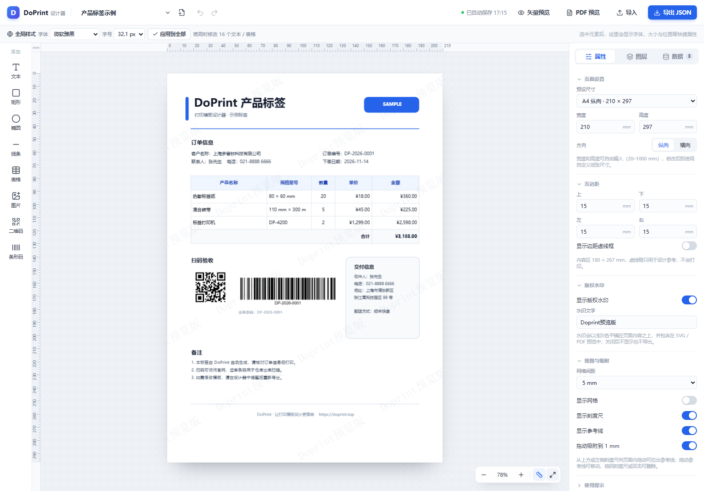

# DoPrint 设计器

面向打印场景的可视化模板设计器。基于 Vue 3 + Vite + Fabric.js，支持文本、图形、图片、专业表格、二维码 / 条形码、数据绑定、毫米刻度尺、参考线、多模板管理，以及 SVG / PDF 预览与导出。

[官网](https://doprint.top) · [在线体验](https://doprint.fios.top) · [GitHub](https://github.com/eonsee/doprint) · [Gitee](https://gitee.com/mayekun/doprint)



*基于在线体验环境的 A4 产品标签示例：表格、二维码 / 条形码、版权水印与页面属性面板*

## 功能特性

- **可视化设计**：文本、矩形、椭圆、线条、图片、表格、二维码、条形码均可拖拽、缩放、旋转，并支持图层排序
- **专业表格**：参考 Univer 的表格数据模型，支持单元格编辑、合并 / 拆分、逐边边框、对齐、加粗、行高列宽与整体缩放
- **数据绑定**：文本、表格单元格、二维码和条形码都支持 `{{字段名}}`，可从示例数据、JSON 或数据库字段中导入
- **打印版式**：画布以毫米为单位，支持 A4 / A5 / B5 / 连续纸 / 标签 / 自定义纸张、页边距可视化、毫米刻度尺、拖拽参考线、网格与吸附
- **二维码 / 条形码**：二维码支持 UTF-8 文本，条形码使用 Code128，可直接绑定订单号等数据
- **版权水印**：可开启 / 关闭平铺水印，默认文字为 `Doprint预览版`，随模板保存并包含在预览 / 导出中
- **多模板管理**：每个模板独立自动保存到浏览器 localStorage，可新建、切换、导入和导出
- **多种输出**：矢量预览并下载 SVG、按打印尺寸预览并下载 PDF、导出 / 导入模板 JSON
- **本地数据源**：通过本机 Node 服务读取 MySQL 库表结构和少量示例数据，密码不落盘
- **撤销 / 重做**：支持完整的编辑历史、快捷键操作和元素位置微调

## 技术栈

| 模块 | 技术 |
| --- | --- |
| 前端框架 | Vue 3 + TypeScript + Vite 4 |
| 画布与交互 | Fabric.js 6 |
| 表格模型 | 自研 Univer 风格稀疏数据模型 |
| 二维码 / 条形码 | `qrcode` + `JsBarcode` |
| PDF 生成 | `pdf-lib` |
| 本地数据服务 | Node.js + Express + `mysql2` |
| 存储 | 浏览器 localStorage（模板 / 示例数据） |

## 快速开始

建议使用 Node.js 18 或更高版本。

```bash
npm install
npm run dev
```

`npm run dev` 会同时启动：

- 设计器（Vite）：http://localhost:5173
- 本地数据服务：http://127.0.0.1:3301

Vite 会将 `/api` 代理到本地数据服务。也可以分别启动：

```bash
npm run dev:web   # 只启动前端
npm run dev:api   # 只启动数据服务
```

生产模式：

```bash
npm run build
npm start
# 打开 http://127.0.0.1:3301
```

## 使用指南

### 模板与页面

- 顶栏模板名旁的「+」可新建空白模板（A4），下拉箭头打开模板列表，可在多个模板之间切换；每个模板独立自动保存到浏览器 localStorage
- 右侧「页面设置」可切换 A4 / A5 / B5 / 连续纸 / 标签等预设，也可直接输入 20–1000 mm 的自定义宽高
- 页边距支持上 / 下 / 左 / 右独立设置，并可用虚线框显示内容区域；虚线框只作设计参考，不会打印
- 从上方刻度尺向下拖动创建水平参考线，从左侧刻度尺向右拖动创建垂直参考线；拖动参考线可调整位置，拖回刻度尺或双击可删除
- 右侧「视图与吸附」中可隐藏或清除全部参考线、显示 / 隐藏网格和刻度尺，并设置网格间距与 1 mm 拖动吸附开关

### 表格

表格采用「数据模型 / 渲染 / 交互」分层的结构，单元格数据参考 Univer 工作表快照设计，表格逻辑不依赖 Fabric：

- `src/designer/table.ts`：纯数据模型与命令。`rowData` / `columnData` 保存行高列宽，`cellData[row][col] = { v, s }` 为稀疏单元格，`mergeData` 使用首尾闭区间，`styles` 是复用的样式注册表；支持默认样式、行样式、单元格样式三级继承
- `src/designer/tableFabric.ts`：把快照渲染为 Fabric `Group`，包含底色、单元格填充、逐边边框和自动换行文本；快照序列化在 `group.tableData` 中，并写入模板的 `element.table`
- `src/designer/tableOverlay.ts`：在 Fabric `after:render` 中以毫米坐标绘制编辑框和选区，不进入序列化 / SVG / PDF
- `src/components/CanvasTableEditor.vue`：只保留单元格文本编辑器和浮动工具栏；命中测试、选区、控制点缩放全部由 Fabric 处理


*双击单元格进入编辑；浮动工具栏支持合并 / 拆分、对齐、加粗和四边边框控制*

操作方式：

- 选中表格后可拖动 8 个控制点缩放，角点按住 Shift 等比缩放；松开后缩放会写回行高 / 列宽，表格恢复 `scaleX / scaleY = 1`，因此保存和导出始终使用真实毫米尺寸
- 表格也可以像其他元素一样旋转：选区、单元格命中测试和内联编辑器都会跟随旋转角度
- 双击表格进入单元格编辑：拖拽框选、Shift 扩展选区；方向键 / Tab 移动，`F2` / Enter 编辑，直接输入即可覆盖，Delete 清空，`Ctrl+A` 全选，Esc 或「完成」退出
- 浮动工具栏支持合并 / 拆分、水平与垂直对齐、加粗，以及分别显示或隐藏选区的四边边框；合并区域按整体参与选择、样式和边框操作
- 右侧「表格」面板可直接调整行数、列数、宽度、高度，并查看当前单元格内容

兼容性：旧版稠密表格（`rows / cols / cells / rowHeights / colWidths / merges`）会在加载时自动迁移为 v2 快照，并保留原有文字、合并、填充、对齐和隐藏边框；数据绑定同样递归解析表格单元格中的 `{{字段}}`。

### 线条、图形与旋转

- 所有元素（文本、图形、图片、表格、线条、二维码 / 条形码）都支持旋转：拖动选中框上方的旋转控制点，或在顶栏 `∠` / 右侧「旋转」中输入角度
- 线条只有左右两个长度控制点，拖拽只会改变长度，不会把线条拉粗；粗细通过顶栏 `粗` 或右侧「粗细」数值定义
- 矩形与椭圆默认无填充，只显示描边；在右侧「填充」中选色即可加上背景，点「清除」恢复透明
- 表格旋转后仍可缩放，缩放会以拖动控制点对面的边 / 角为锚点写回真实行高列宽，不会发生跳位

### 版权水印与二维码 / 条形码

- 右侧「属性 → 版权水印」可开启 / 关闭平铺的版权水印，默认文字为 `Doprint预览版`，文字可修改
- 水印绘制在页面内容之上，随模板保存；开启时会包含在矢量预览、PDF 预览与导出中，关闭后不显示也不导出
- 左侧工具栏的「二维码」「条形码」按钮可插入对应元素，选中后在右侧修改内容，支持 `{{字段名}}` 数据绑定
- 二维码使用 UTF-8 编码；条形码使用 Code128，支持字母、数字和常用符号
- 两者和其他图片元素一样可以拖拽、缩放、旋转，并保持毫米尺寸；内容修改后会自动重新编码，不改变已设置的外框尺寸


*选中二维码后可编辑内容、绑定数据字段，缩放和旋转不会改变内容*

### 数据绑定

- 在文本或表格单元格中输入 `{{字段名}}`，预览和导出时会替换为示例数据中的对应值
- 二维码 / 条形码的内容同样支持绑定，例如订单号、物流单号等
- 右侧「数据」标签可维护示例数据，也支持导入 JSON；从数据库导入字段时，列名和首行示例值会合并到示例数据
- 设计画布保留 `{{字段名}}` 原文，方便继续编辑；替换发生在预览 / 导出阶段

### 预览与导出

- **矢量预览**：生成按打印尺寸缩放的 SVG，可下载后继续用于印刷或排版，水印、表格和二维码 / 条形码都会包含在内
- **PDF 预览**：使用 `pdf-lib` 按实际毫米尺寸生成 PDF，可在线预览并下载
- **导出 JSON**：保存当前模板及示例数据，可在其他浏览器或设备上通过「导入」恢复
- 顶栏会自动显示保存状态；模板内容变化后自动写入 localStorage


*矢量预览会保留表格、二维码 / 条形码和版权水印，可直接下载 SVG*

### 数据源

浏览器无法直接建立数据库的 TCP 连接，因此由 `server/index.mjs` 提供本机数据服务，前端通过 `/api/datasource/*` 读取库表结构。


*数据库类型选择：当前支持 MySQL，PostgreSQL / SQL Server 已预留入口*

1. 打开右侧「数据」标签，在「数据源」中点击「连接数据源」
2. 在弹窗中选择数据库类型（当前支持 MySQL，PostgreSQL / SQL Server 标记为即将支持）
3. 填写主机、端口、用户、密码，点击「连接」
4. 选择数据库和数据表，勾选需要的字段，点击「导入 N 个字段」
5. 列名和首行示例值会合并到「示例数据」，可直接用 `{{字段名}}` 绑定

说明：

- 密码只随当前请求发送，不写入 localStorage 或模板文件；刷新页面后需要重新输入
- 主机、端口、用户、数据库会记住，方便下次连接
- 数据服务默认只监听 `127.0.0.1`，不对外网开放
- 只执行元数据查询和 `SELECT * ... LIMIT 1~20`，没有任意 SQL 接口
- 库名、表名会先通过 `information_schema` 校验，查询中的标识符使用 `mysql2` 转义
- 建议为设计器单独创建一个只读数据库账号
- 后端按驱动组织（`server/index.mjs` 中的 `DRIVERS`），新增 PostgreSQL / SQL Server 时补充 `connect`、`tables`、`columns` 三个方法即可；弹窗中的类型选择已预留
- 弹窗中的数据库图标来自 [Devicon](https://devicon.dev)（MIT）与 [Simple Icons](https://simpleicons.org)（CC0），商标归各自所有者

#### 服务端配置

| 环境变量 | 默认值 | 说明 |
| --- | --- | --- |
| `API_PORT` | `3301` | 数据服务端口（Vite 代理会读取同名变量） |
| `API_HOST` | `127.0.0.1` | 数据服务监听地址 |
| `MYSQL_HOST` / `MYSQL_PORT` / `MYSQL_USER` / `MYSQL_PASSWORD` | - | 直接调用 API 时的 MySQL 连接默认值 |

界面中的连接表单优先于环境变量；密码输入框不会从环境变量回填。

## 快捷键

| 快捷键 | 功能 |
| --- | --- |
| `Ctrl/Cmd + Z` | 撤销 |
| `Ctrl/Cmd + Shift + Z` / `Ctrl/Cmd + Y` | 重做 |
| `Ctrl/Cmd + D` | 复制选中元素 |
| `Delete` / `Backspace` | 删除选中元素 |
| `方向键` | 移动选中元素 0.5 mm |
| `Shift + 方向键` | 移动选中元素 5 mm |
| `Esc` | 清除选择 / 退出表格单元格编辑 |

表格编辑中：`方向键` / `Tab` 移动单元格，`F2` / `Enter` 进入编辑，`Ctrl/Cmd + A` 全选，拖拽可框选区域。

## 项目结构

```text
server/
  index.mjs              本机数据服务（Express + mysql2）
src/
  App.vue                页面布局与全局快捷键
  components/            顶栏、工具栏、属性面板、图层面板、表格编辑器、预览弹窗等
  designer/
    designer.ts          Fabric 画布、元素操作、历史记录、序列化与预览
    table.ts             表格数据模型与命令
    tableFabric.ts       表格的 Fabric 渲染
    tableOverlay.ts      表格编辑框与选区绘制
    binding.ts           {{字段}} 数据绑定
    codes.ts             二维码 / 条形码生成
    pdf.ts               PDF 生成与预览
    types.ts             模板与元素类型定义
    units.ts             px / mm 换算
docs/images/             README 截图
```

## 部署到 Vercel / Cloudflare Pages

设计器前端是纯静态的 Vite 应用，可直接部署到 Vercel 或 Cloudflare Pages 做在线预览：

- Vercel：导入 GitHub 仓库，Framework Preset 选择 Vite。仓库已提供 `vercel.json`，构建命令 `npm run build`，输出目录 `dist`
- Cloudflare Pages：导入仓库，Framework Preset 选择 Vite，构建命令 `npm run build`，输出目录 `dist`；也可以使用 `npx wrangler pages deploy dist` 直接发布，`wrangler.toml` 中的项目名可按需修改
- 顶栏左上角 DoPrint 标志 / 文字会在新标签页打开官网 https://doprint.top
- 在线体验地址：https://doprint.fios.top

在线预览限制：

- 模板保存在浏览器 localStorage，不同设备 / 浏览器之间不共享
- 数据源连接依赖本机 `server/index.mjs` 的 Node 服务和可访问的 MySQL，纯静态部署不可用。线上如需数据库连接，Vercel 需要把 `server/index.mjs` 适配为 Serverless Function 并连接公网数据库；Cloudflare Workers 无法直接使用 `mysql2` 的 TCP 连接，需要 Hyperdrive 或独立 HTTP 后端

## 说明

- 建议使用最新版 Chrome / Edge 等现代浏览器
- 画布以毫米为设计单位，字号在界面中以 px 展示，便于和常见设计稿对照
- 模板与示例数据默认保存在浏览器 localStorage，重要模板建议定期使用「导出 JSON」备份
- 二维码 / 条形码只保存内容文本，加载模板时重新生成，避免模板文件因图片体积过大
